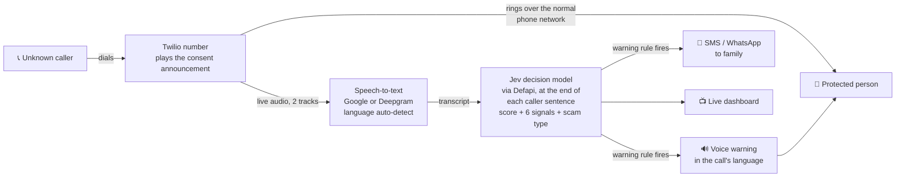

# 🛡️ Wessuwan

**An AI guardian that protects elderly people from phone scams, in real time, during the call.**

Wessuwan listens to calls from unknown numbers as they happen. When the caller starts using scam tactics, such as "you'll be arrested today", "read me the code we just texted" or "buy gift cards", it plays a calm warning in the call and texts the family, **before any money moves**. The protected person needs no app and no smartphone: it works with any phone.

> *Wessuwan is named after Thao Wessuwan, the guardian king in Thai and Buddhist tradition who protects people from evil and guards their treasure. Today the evil comes by phone, and Wessuwan protects people and their savings.*

- 🌐 **Live demo:** [DEMO_SITE_URL](#) *(placeholder)*. Try the detector in your browser, no phone call needed.
- 📑 **Pitch deck:** [PITCH_DECK_URL](#) *(placeholder)*
- 🔒 [Privacy notice](PRIVACY.md) · [Security policy](SECURITY.md)

## The problem

Scammers pretend to be the tax office, Social Security, the bank's fraud team, the police, tech support or a grandchild in trouble. They create fear and urgency, keep the victim on the line, and push for gift cards, crypto, wire transfers, a "safe account" or a verification code. Older adults lose the most, and they are often alone on the phone with no one to ask.

*Fill in with current figures and sources:*

- **[STAT]** reported losses to fraud by people aged 60+ in [COUNTRY/YEAR] ([source](#)).
- **[STAT]** of scam contacts start with a phone call ([source](#)).
- **[STAT]** median loss per elderly victim, versus **[STAT]** for younger adults ([source](#)).
- **[STAT]** of elder fraud is never reported ([source](#)).

Awareness campaigns help, but they don't reach the moment that matters: the call itself. Wessuwan steps in during the call.

## How it works



1. **Call.** A caller dials the Wessuwan (Twilio) number. Trusted contacts ring straight through and are **never processed**. Everyone else first hears *"This call is protected by Wessuwan, an AI scam protection service."* No audio reaches the AI until that announcement has finished.
2. **Listen.** Both sides of the call are streamed as separate tracks (8 kHz mu-law) to Google Speech-to-Text or Deepgram, with automatic language detection.
3. **Judge.** At the end of each caller sentence, **[Jev](https://defapi.org/model/typesafe/jev-1.13)**, TypeSafe's decision model, answers one typed request through Defapi. It returns a 0-4 `scam_likelihood` score with a confidence, the probability of six warning signals (urgency, threat, asks for codes or data, asks for money, claims to be an authority, asks for secrecy), and the scam type. Simple, auditable rules decide when to warn (see [The detector](#the-detector-jev) below). The warning's reason is built from templates, so nothing waits on a chat model. Country profiles add local context (IRS, HMRC, CRA, ATO, *ore ore sagi*, *Enkeltrick*…) and the right reporting hotline.
4. **Protect.** At high risk the protected person hears: *"Warning from Wessuwan: this call may be a scam. Do not send money or share any codes. Hang up and call your family."* (in the call's language when available). The family gets: *"Wessuwan ALERT: Mom may be on a scam call right now. Caller claims to be a government agency and is asking for gift cards. Risk 92/100. Call Mom now."* Optionally, the call is hung up automatically.

## The detector: Jev

Wessuwan asks [Jev](https://defapi.org/model/typesafe/jev-1.13) (`typesafe/jev-1.13`, pinned so the thresholds stay tuned) one request per check through Defapi's Decisions API (`POST https://api.defapi.org/api/v1/decisions`, set by `JEV_URL`). The request's `state` is `{ transcript, country }`, with lines labeled "Caller:" and "Protected person:". It has 8 typed questions:

| Question | Type | Answer used |
|---|---|---|
| `scam_likelihood` | score, 5 levels: Not a scam · Unlikely · Possible · High chance · Definitely a scam | `score` (0-4, probability-weighted) and `confidence` |
| `urgency`, `threat`, `asks_for_codes_or_data`, `asks_for_money`, `impersonating_authority`, `asks_for_secrecy` | noul (yes/no) | probability of yes; **detected at ≥ 0.7** |
| `scam_type` | choice over the 19 global scam types incl. `none` | the chosen type |

**Risk** = `score / 4 × 100`. The dashboard shows green under 40, yellow "Watching closely" from 40 to 69, and red at 70 and above.

**Warn the person and alert the family** ("scam-detected") when any of these is true:

1. `score ≥ JEV_WARN_SCORE` (3.5) **and** `confidence ≥ JEV_WARN_CONFIDENCE` (0.7). Jev is sure it's a scam.
2. `score ≥ JEV_HIGH_SCORE` (2.5) on **two checks in a row**. The risk is consistently high.
3. *asks for money* or *asks for codes/data* is detected **together with** *claims to be an authority*. This is the pattern real organizations never use.

Once the warning fires, the call stays red for the rest of the call. The reason comes from the detected signals and scam type, using templates in `locales/en.json`, e.g. *"Caller claims to be from your bank, asks you to move or send money, and says to keep it secret."*

**When it checks.** A check runs when a caller sentence ends: Deepgram's end of speech (`speech_final` after `STT_ENDPOINTING_MS` of silence, default 600 ms, backed up by `UtteranceEnd`), or Google's final result. Protected-person lines go into the transcript but don't trigger a check on their own. Only one check runs at a time: if a caller sentence ends while one is running, exactly one more check runs with the latest transcript as soon as it finishes, so the latest sentence is never skipped. If the caller talks for `LONG_SPEECH_CHECK_MS` (4 s) without a final result, the partial text is checked.

**Code-request fast path.** Every caller sentence is also matched, with zero delay, against keyword patterns for code requests (*"read it back to me"*, *"tell me the verification code"*, *"what's your PIN"*, OTP, passcode…). A match warns at once (rule *code request (keyword)*) without waiting for Jev, so the warning lands before the person can read the code out. Reassurances like *"we won't ask for any codes"* and *"never share this code"* don't match.

**Reliability.** Each request has a 3-second timeout. A failed, slow or rate-limited check is logged and backed off, then retried with the latest transcript, and the call is never affected. Transcripts over `MAX_TRANSCRIPT_BYTES` (24 KB) keep their most recent lines, staying under Jev's ~32 KB long-context cutoff. With `JEV_FALLBACK=llm`, a call switches to the older chat-model detector (Gemini or Claude, `DETECTOR=llm`) after 3 Jev failures in a row.

**Cost.** Jev bills input tokens only, and every response reports `usage.cost`. `npm run test:detector` replays all 16 sample calls with a check at the end of each caller line and prints a timeline per call (when each check started and finished, and when the warning fired), plus the cost per check and per call.

> ⚠️ **Check Defapi's and TypeSafe's data policy before using real users' calls.** The [Jev model page](https://defapi.org/model/typesafe/jev-1.13) and Defapi's terms say how prompts are logged, retained or used. Until you've confirmed a no-training, minimal-retention setup and a data processing agreement, use Jev only with test data such as the sample scripts and the public demo.

## Privacy by design: "we can't leak what we don't keep"

- **No audio is ever stored.** It passes through memory to speech-to-text and is gone. Nothing is written to disk or logs.
- **Transcripts live only in memory during the call.** Normal calls are deleted the moment they end (`[Wessuwan] [privacy] normal call, data deleted`).
- **Only a short scam summary is kept**: date, caller, scam type, risk, a one-sentence reason and which alerts were sent. It is encrypted with **AES-256-GCM** (`ENCRYPTION_KEY`) and auto-deleted after `SUMMARY_RETENTION_DAYS` (default 30). Without a key, nothing is kept.
- **Consent first.** Protection only starts after consent is recorded on the setup page. The caller announcement is mandatory and always on.
- **Trusted contacts are never processed.** Protection can be switched off at any time, and **Delete all my data** removes summaries, contacts and the consent record in one click.
- **Masked logs.** Phone numbers always appear as `+1***-***-1234`. Transcripts are never logged in production (`LOG_LEVEL=info`).
- **Hardened.** HTTPS/WSS only in production, Twilio webhook signature validation, helmet security headers, a password-protected setup page.

> ⚠️ **Free AI tiers may use your data for training. Use them only with test data** such as the sample scripts and the public demo. Protecting real people requires **paid tiers with no-training and zero (or minimal) data retention settings**, under a data processing agreement with every provider: Defapi and TypeSafe (Jev), Google Cloud / Gemini API paid tier, Anthropic API (zero data retention on request), Deepgram, Twilio. See [PRIVACY.md](PRIVACY.md).

## Tech stack

| Part | Technology |
|---|---|
| Telephony & alerts | Twilio Programmable Voice, Media Streams, SMS, WhatsApp |
| Speech-to-text | Google Cloud Speech-to-Text (multi-language detection) or Deepgram nova-3 (`multi` mode), both streaming 8 kHz mu-law |
| Scam detection | **Jev** (`typesafe/jev-1.13`) via Defapi's Decisions API: typed score, yes/no and choice answers with probabilities. Optional fallback: Gemini or Claude chat models |
| Server | Node.js 22, TypeScript, Express 5, Socket.IO, ws, helmet, zod |
| Privacy | AES-256-GCM (Node crypto), automatic retention, masked logging |
| Frontend | Plain HTML/JS, `locales/en.json` for every UI string |

## Run it locally

Requires Node.js 20+.

```bash
git clone <this repo> && cd wessuwan
npm install
cp .env.example .env        # every variable is explained there
```

### Quickest: no phone, no Twilio

Set `JEV_API_KEY` in `.env` (a Defapi key, from [defapi.org](https://defapi.org/model/typesafe/jev-1.13)), then:

> **Jev provider:** Wessuwan uses [Defapi](https://defapi.org/model/typesafe/jev-1.13) as its Jev provider for both the demo and production (`JEV_URL=https://api.defapi.org/api/v1/decisions`, the default, with the key in `JEV_API_KEY`). If needed, point `JEV_URL` at another Jev provider that serves the same Decisions API, such as OpenRouter (`https://openrouter.ai/api/alpha/decisions`).

```bash
PUBLIC_DEMO=true npm run dev
```

Open http://localhost:3000 for the homepage, **Try it** (`/try`), the **dashboard** with Demo mode (`/dashboard`), and **setup** (`/setup`, read-only in demo mode).

```bash
npm run test:detector                       # replays all 16 sample calls through Jev line by line, prints a results table
npm run test:detector -- --detector=llm     # same with the chat-model detector
npx tsx scripts/jev-test.ts                 # one raw Jev request per sample transcript, prints the raw responses
npm run test:stt -- caller.wav --provider=google          # streams a WAV through speech-to-text
```

### With real phone calls

1. In `.env`, set the Twilio values, `STT_PROVIDER` with its credentials, an AI key, `PUBLIC_URL`, `ENCRYPTION_KEY` and `COUNTRY`.
2. Expose the server: `ngrok http 3000`, then put the HTTPS URL in `PUBLIC_URL`.
3. In the Twilio Console, set your number's **A call comes in** webhook to `https://<ngrok-url>/twilio/voice` (HTTP POST).
4. Open `/setup`. Enter the protected person, record consent, and add trusted contacts and family numbers. Press **Send test alert**, and follow the call-forwarding instructions on the page.
5. Optional: record `public/audio/warning.mp3` (and `warning-<lang>.mp3` for other languages). If it's missing and Google credentials are set, it's generated with Google Text-to-Speech.
6. Call the Wessuwan number from a phone that isn't a trusted contact.

See [DEMO.md](DEMO.md) for the live-demo runbook and [DEPLOY.md](DEPLOY.md) to put the public demo online for free.

### Countries

`COUNTRY` selects a profile in [`config/countries/`](config/countries) (US, UK, CA, AU, JP, SG, DE). Each profile sets the default language, the national scam-reporting hotline, common local scams with example phrases (added to the AI prompt), and whether all-party consent applies. To add a country, add a JSON file. To add a UI language, add `locales/<lang>.json` and list it in `public/i18n.js`.

## Project layout

```
src/
  index.ts         Express + helmet + Socket.IO + Twilio media WebSocket
  events.ts        Typed event bus (transcript-update, risk-update, ...)
  settings.ts      Setup-page settings + consent, encrypted at rest
  call/            Twilio webhook (announcement, signature check), media stream, SMS
  stt/             Google and Deepgram streaming speech-to-text
  detector/        jev.ts (Jev questions, rules), reason.ts (templates), chat-model fallback
  alerts/          Voice warning (multilingual), family SMS/WhatsApp, auto hang-up
  privacy/         AES-256-GCM, encrypted summaries + retention, masked logging
  dashboard/       Live dashboard feed + Demo mode replay
  tryit/           Public demo API (samples, rate-limited /api/check)
  setup/           Setup API (settings, consent, protection switch, delete my data)
config/countries/  Country profiles
locales/           UI text (en.json)
public/            Homepage, Try it, dashboard, setup, privacy pages
data/test-scripts/ 11 scam + 5 normal English call scripts
```

## License

[MIT](LICENSE)
